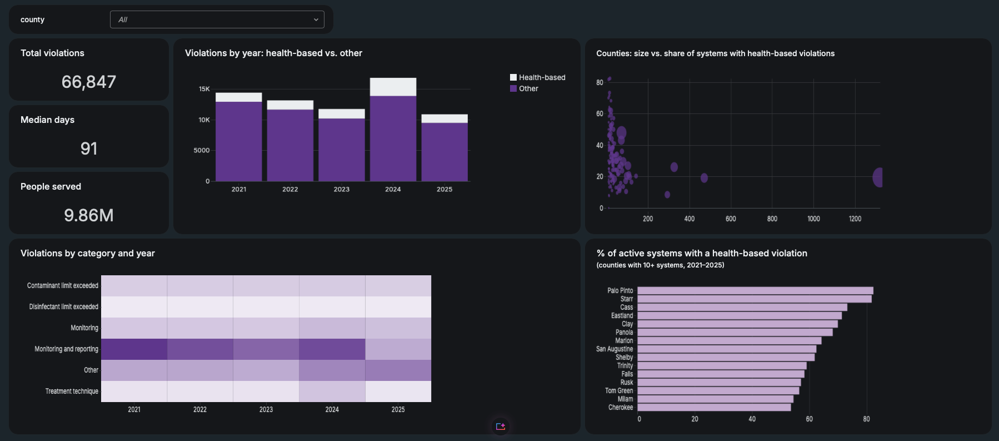

# Texas Drinking Water Compliance Pipeline

> **Which public water systems in Texas violate drinking water regulations, what kinds of violations are most common, and how quickly are they resolved?**

My first end-to-end data engineering project, built on **Databricks Free Edition** with PySpark, SQL and
Delta Lake, following the Medallion architecture (Landing, Bronze, Silver, Gold). It uses public data from the
US EPA Safe Drinking Water Information System (SDWIS), published through ECHO, and runs as a monthly
scheduled job that feeds an AI/BI dashboard.

**Project page:** [fernandaanalytics.com/texas-water](https://fernandaanalytics.com/texas-water/)

> **Scope note:** this project analyzes **regulatory compliance**. It does not claim that the water in any
> specific city is safe or unsafe. Violation data has known limitations and reporting delays.



## Key numbers (EPA release 2026-10-14, violations that began 2021–2025)

| Metric | Value |
|---|---|
| Violations in Texas | **66,847** |
| Health-based violations | **~8,880** (about 13%) |
| People served by active community systems with at least one health-based violation | **9.86M** |
| Median time to return to compliance | **91 days** |
| Peak year | **2024** (~16,780 violations) |
| Highest share of systems with a health-based violation (counties with 10+ systems) | **80%+** (Palo Pinto, Starr) |

"People served" is each system's population counted once, not the number of people exposed to a problem.

## Architecture

```
EPA ECHO (SDWA zip, ~558 MB, national)
        │
   01_landing   → Unity Catalog Volume, original files kept per EPA release date
        │
   02_bronze    → Texas rows only (PWSID starts with "TX") + lineage columns    1,073,753 rows
        │
   03_silver    → deduplicated, typed, codes decoded, no personal data          296,146 violations
        │
   04_gold      → star schema: dim_water_system, fact_violations, county_summary 66,847 violations (2021–2025)
        │
   AI/BI dashboard (county filter)
```

- **Catalog:** `workspace` · schemas `sdwa_bronze`, `sdwa_silver`, `sdwa_gold`
- **Orchestration:** Lakeflow Job `texas_water_pipeline`, 4 notebook tasks, runs on day 1 of each month
  (06:00 America/Chicago) on serverless compute. A full run takes about 5 minutes.

## Engineering decisions

- **Deduplication:** the source has one row per violation + enforcement pair, which inflated rows ~3.6×.
  Silver keeps one row per `PWSID` + `VIOLATION_ID` (1,073,753 → 296,146).
- **Quality checks:** 10,212 enforcement rows had no violation ID. They were kept out of violation counts.
- **No personal data:** administrator name, email and phone columns are dropped in Silver.
- **One county per system:** 4 systems serve more than one county. A fixed rule (`MIN(county)`) assigns each
  to one county, so none is counted twice. 97 systems without a county are labeled `Unknown county`.
- **Fair rankings:** counties need 10+ active systems to be ranked, so a county with one system can't show 100%.
- **No double counting:** population counts each system once (`DISTINCT pwsid` before `SUM`), and Gold
  aggregates in CTEs before joining to avoid fan-out.

## Repository structure

```
notebooks/    Databricks notebooks, one per pipeline step (01_landing → 04_gold)
jobs/         Lakeflow Job definition (texas_water_pipeline.yml)
dashboards/   AI/BI dashboard definition (.lvdash.json)
images/       Dashboard screenshot
```

## How to run

1. Create a Databricks Free Edition workspace and add this repository as a **Git folder**.
2. Run the notebooks in order: `01_landing_download` → `02_bronze` → `03_silver` → `04_gold`.
   The landing notebook creates the schemas and the Volume, downloads the EPA file and extracts it.
3. Optional: create the job from `jobs/texas_water_pipeline.yml` and import the dashboard from `dashboards/`.

Raw data files are not stored in this repository.

## Data source

- **EPA ECHO – SDWA Data Download:** [download summary](https://echo.epa.gov/tools/data-downloads/sdwa-download-summary)
  (refreshed quarterly)

## Next challenges

- Genie space for natural-language questions over the Gold tables
- Census ACS data (household plumbing access by county) as a second landing source
- Wastewater compliance (EPA ICIS-NPDES)

## Tech

Databricks Free Edition · PySpark · SQL · Delta Lake · Unity Catalog · Lakeflow Jobs · AI/BI Dashboards · GitHub
